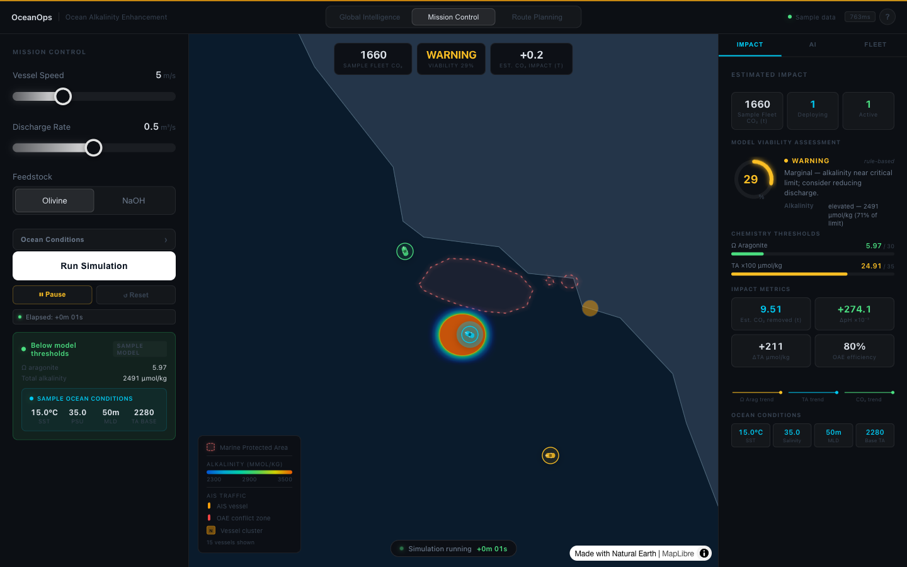
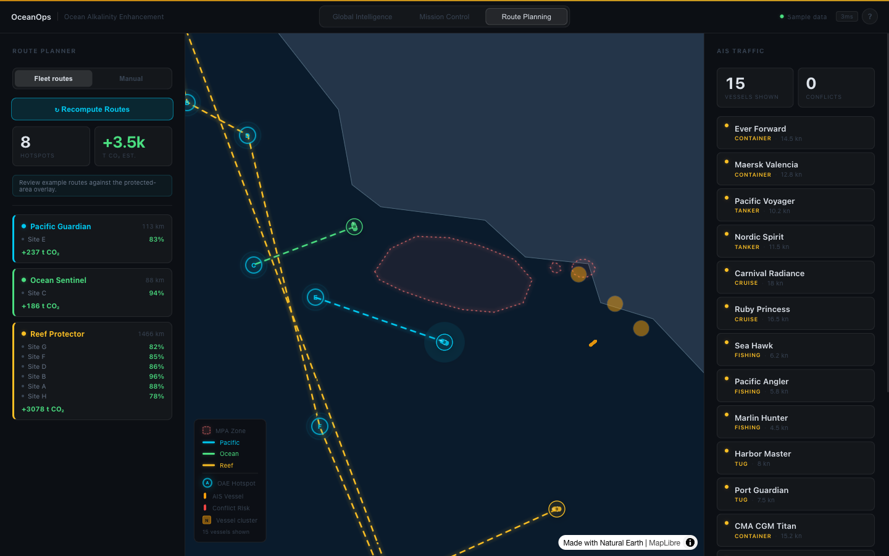

# OceanOps

**A shipboard planning prototype for ocean alkalinity enhancement.** Change a vessel’s speed, discharge rate, or feedstock to see how the modeled alkalinity plume changes. Then explore sample fleet routes alongside marine traffic and protected areas.

**🏆 1st Place, ASUS Challenge · LA Hacks 2026**

[Open the interactive demo](https://oceanops.vercel.app) · [Run locally](#run-locally) · [Team and contributions](#team)



## Try it

1. **Mission Control.** Change the discharge rate and select **Run Simulation**. Compare the plume heatmap, peak alkalinity, and aragonite saturation. Open the **AI** tab for the demo’s rule-based explanation.
2. **Global Intelligence.** Select **Discover Optimal Zones** to rank five example sites. Open a site to see its modeled conditions and impact estimates.
3. **Route Planning.** Select **Compute Fleet Routes** to draw routes for three sample vessels, or switch to **Manual** and place your own waypoints on the map.



The public demo uses bundled ocean conditions, sample fleet telemetry, simulated movement from historical AIS records, and approximate protected-area boundaries. Its plume, chemistry thresholds, and carbon estimates are illustrative. Use official marine charts and validated models for navigation, operational planning, and carbon accounting.

## How it works

The React dashboard sends a scenario to FastAPI. The default demo runs a lightweight NumPy plume model and returns the grid and summary metrics. MapLibre draws the plume, fleet, traffic, and routes over a bundled Natural Earth basemap. Route Planning streams site scores as they arrive so the dashboard can start drawing routes before the full response finishes.

The local backend also contains integrations for NOAA and CalCOFI ocean data, AISStream vessel traffic, NATS fleet telemetry, Gemma via Ollama, and a Julia/Oceananigans solver. Those integrations are optional for running the showcase.

## Run locally

Use **Python 3.11** and **Node.js 22**. The interactive map requires a WebGL 2-capable browser.

From a fresh clone, start the API in one terminal:

```bash
cd backend
python3.11 -m venv .venv
source .venv/bin/activate
python -m pip install -r requirements.txt
cp .env.example .env
python -m uvicorn main:app --host 127.0.0.1 --port 8001
```

In a second terminal, from the repository root:

```bash
cd frontend
npm ci
npm run dev
```

Open [localhost:3000](http://localhost:3000). The sample scenario runs without credentials, a mapping token, or a model download. Vite proxies API calls to the local backend.

For the connected prototype, set `OCEANOPS_DEMO=false` in `backend/.env`. For local language-model analysis, start Ollama and pull the configured model with `ollama pull gemma4:e4b`. AISStream credentials stay in the backend environment. For NATS telemetry, start `nats-server -c nats-server.conf` at the repo root and set `VITE_NATS_WS_URL=ws://localhost:9222` in `frontend/.env` before starting Vite. See [backend settings](backend/.env.example) and [frontend settings](frontend/.env.example).

## Team

Built at LA Hacks 2026 by [Akshat Choudhari](https://github.com/A-Choudhari), [Yashmit Bhaverisetti](https://github.com/yashmitb), and [Thaarak Sriram](https://github.com/Thaarak).

**Thaarak’s hackathon contributions** included [NATS fleet telemetry and HTTP fallback](https://github.com/A-Choudhari/LaHacks26/commit/3491c89), [AI analysis, map overlays, and simulation flow](https://github.com/A-Choudhari/LaHacks26/commit/fa84195), and [route rendering fixes](https://github.com/A-Choudhari/LaHacks26/commit/05af552).

## Data credits

Basemap data from [Natural Earth](https://www.naturalearthdata.com/about/terms-of-use/). Sample records and the connected prototype draw on [CalCOFI](https://calcofi.org/), NOAA ocean data, and historical [MarineCadastre AIS](https://marinecadastre.gov/ais/) records.

## License

The project code is provided under the [MIT License](LICENSE). External datasets and software dependencies retain their own terms.
